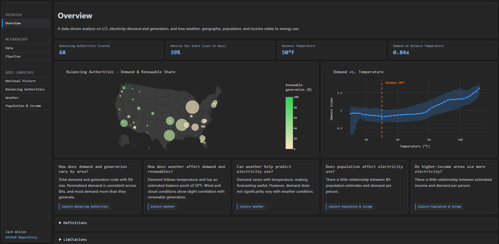

# U.S. Electricity Demand & Generation Analysis

A data-driven analysis on U.S. electricity demand and generation, and how weather, geography, population, and income relate to energy use.

The project pulls hourly electricity data from the EIA API and weather data from Open-Meteo, combines them with static datasets (population, income, balancing authority information, etc.), loads everything
into a PostgreSQL database, and visualizes the results in an interactive dashboard. The pipeline is orchestrated with Apache Airflow and runs hourly.



> ### This is an overview. A full written report can be found [here](docs/report.md).

---

## Questions & Takeaways

| Question | Takeaways |
| ----- | ----- |
| 1. How does demand and generation vary by area? | Total demand and generation scale with BA size. Normalized demand is consistent across BAs, and most demand more than they generate. |
| 2. How does weather affect demand, generation, and renewables? | Demand follows temperature and has an estimated balance point of 50°F. Wind and cloud conditions show slight correlation with renewable generation. |
| 3. Can weather help predict electricity use? | Demand varies with temperature, making forecasting useful. However, demand does not significantly vary with weather condition. |
| 4. Does population affect electricity use? | There is little relationship between BA population estimates and demand per person. |
| 5. Do higher income areas use more electricity? | There is little relationship between estimated income and demand per person. |

---

## Tools
| Category | Tools |
| ----- | ----- |
| Language | Python, SQL |
| APIs | EIA API, Open-Mateo API |
| Database | PostgreSQL, DBeaver |
| Orchestration | Apache Airflow | 
| Dashboard | Dash, Plotly |

---

## Project Structure
```bash
.
├─ airflow/
│  ├─ requirements.txt
│  └─ ...
├─ app/
│  ├─ assets/
│  ├─ main.py # Run app
│  ├─ requirements.txt # Install for app
│  └─ ...
├─ dags/
│  └─ electricity_etl_dag.py
├─ data/ # Static data here
│  ├─ 2020_Gaz_counties_national.txt
│  ├─ Balancing_Authority_2025.xlsx
│  └─ out_eia861__yearly_balancing_authority_service_territory.parquet
├─ db/
│  ├─ electricity_erd.png
│  ├─ electricity_schema.sql # Run database schema
│  └─ ...
├─ docs/
│  ├─ plan.md
│  ├─ report.md # Report
│  └─ ...
├─ src/
│  └─ electricity/
│     ├─ main.py # Run pipeline
│     └─ ...
├─ .env.example
├─ .gitignore
├─ compose.yaml
├─ README.md # You are HERE
└─ requirements.txt # Install for pipeline
```

---

## Set Up

### Prerequisites

- Python
- Free [EIA API Key](https://www.eia.gov/opendata/)
- [Docker Desktop](https://www.docker.com/products/docker-desktop/) (optional, Airflow Route)
- SQL Client like [DBeaver](https://dbeaver.io/download/) (optional, viewing tables)

### 1. Download static data

Download the files below and place them in the `data/` folder.

| File | Status | Source | Notes |
| ----- | :-----: | :-----: | -----: |
| `2___Plant_Y2025.xlsx`| Required | [link](https://www.eia.gov/electricity/data/eia860/xls/eia8602025.zip) | Only pull `2___Plant_Y2025.xlsx` from the zip |
| `CAINC1_ALL_AREAS_1969_2024.csv` | Required | [link](https://apps.bea.gov/regional/zip/CAINC1.zip) | Only pull `CAINC1_ALL_AREAS_1969_2024.csv` from the zip |
| `sub-est2025.csv` | Required | [link](https://www2.census.gov/programs-surveys/popest/datasets/2020-2025/cities/totals/sub-est2025.csv)| |
| `2020_Gaz_counties_national.txt` | Only if missing | [link](https://www2.census.gov/geo/docs/maps-data/data/gazetteer/2020_Gazetteer/2020_Gaz_counties_national.zip) | |
| `Balancing_Authority_2025.xlsx` | Only if missing | [link](https://www.eia.gov/electricity/data/eia861/zip/f8612025.zip) | Only pull `Balancing_Authority_2025.xlsx` from the zip |
| `out_eia861__yearly_balancing_authority_service_territory.parquet` | Only if missing | [link](https://s3.us-west-2.amazonaws.com/pudl.catalyst.coop/nightly/out_eia861__yearly_balancing_authority_service_territory.parquet) | |

### 2. Configure environment variables

Copy `.env.example` to `.env` and fill in your values.

```yaml
EIA_API_KEY=eia_api_key # Required 
DB_HOST=localhost
DB_PORT=5433
DB_USER=your_username # Required 
DB_PASSWORD=your_password # Required 
DB_DATABASE=your_db # Required 
DB_SCHEMA=electricity 
DB_ENGINE_URL=postgresql+psycopg://${DB_USER}:${DB_PASSWORD}@${DB_HOST}:${DB_PORT}/${DB_DATABASE}?options=-c%20search_path=${DB_SCHEMA}
EIA_INITIAL_START=2026-07-17 # Optional (delete)
WEATHER_INITIAL_START=2026-07-17 # Optional (delete)
```

| Variable | Required | Default | Notes |
| ----- | :-----: | :-----: | -----: |
| `EIA_API_KEY` | Yes | | Your [EIA API key](https://www.eia.gov/opendata/) |
| `DB_USER` | Yes | | Database username |
| `DB_PASSWORD` | Yes | | Database password |
| `DB_DATABASE` | Yes | | Database name (postgres) |
| `EIA_INITIAL_START` | No | 90 days | Start of initial EIA backfill window in in `YYYY-MM-DD` format. |
| `WEATHER_INITIAL_START` | No | 90 days | Start of initial weather backfill window in in `YYYY-MM-DD` format. |

> Remove the two `*_INITIAL_START` lines to use the 90-day defaults.

> Never commit your `.env` file. Make sure it's in `.gitignore`.

### 3. Run the pipeline

Choose **one** of the two options.

#### Option A: Airflow (Docker)
1. Open Docker Desktop and navigate to the project directory.

2. Build and start the containers.

```powershell
docker compose up -d --build
```

3. Get the generated Airflow username and password.

```powershell
docker exec -it airflow /bin/bash
```

```powershell
cat simple_auth_manager_passwords.json.generated
```

4. Open http://localhost:8080/ and login with credentials.

5. Enable `electricity_etl_dag` or trigger manually. 

> The first run backfills historical data and takes about **1.5 hours**. The DAG will run **hourly** after that.

6. To browse the tables, create a connection in DBeaver using your `DB_USER`, `DB_PASSWORD`, `DB_DATABASE`, and `DB_PORT` 5433.

#### Option B: Manual

1. Open a terminal and navigate to the project directory.

2. Create and activate a virtual environment.

```powershell
python -m venv .venv
```

```powershell
.\.venv\Scripts\Activate.ps1
```

3. Install requirements.

```powershell
pip install -r requirements.txt
```

4. Create the schema by running `db/electricity_schema.sql` in DBeaver.

5. Run pipeline [from file](/src/electricity/main.py) or...

```powershell
python src/electricity/main.py
```

### 4. Run the dashboard

```powershell
cd app
```

```powershell
pip install -r requirements.txt
```

[Run from file](/app/main.py) or...

```powershell
python main.py
```

Then open <http://127.0.0.1:8050/>.

---

## Data Sources
| Source | Used For |
| ----- | ----- |
| [EIA Open Data API](https://www.eia.gov/opendata/) | Hourly demand and generation by fuel type |
| [Open-Meteo Historical API](https://open-meteo.com/en/docs/historical-forecast-api) | Weather data |
| [EIA-860 Plant Data (2025)](https://www.eia.gov/electricity/data/eia860/) | Power plant locations |
| [Census Population Estimates](https://www.census.gov/data/tables/time-series/demo/popest/2020s-total-cities-and-towns.html) | Population by county |
| [Census Gazetteer Files](https://www.census.gov/geographies/reference-files/time-series/geo/gazetteer-files.2020.html#list-tab-264479560) | County geography |
| [PUDL BA Service Territories](https://data.catalyst.coop/preview/pudl/out_eia861__yearly_balancing_authority_service_territory) | Balancing Authority territories |
| [EIA-861](https://www.eia.gov/electricity/data/eia861/) | Additional Balancing Authority territory data |
| [BEA Regional Income (CAINC1)](https://apps.bea.gov/regional/zip/CAINC1.zip) | Income by county |

---

## Troubleshooting
 
- **Airflow login fails:** re-run the `cat simple_auth_manager_passwords.json.generated` step. Credentials get regenerated when the container is rebuilt.
- **Cannot connect to the database:** confirm `DB_PORT` is `5433` and that the database container is running.
- **Missing file errors on first run:** check that every "Required" file in `data/` matches the exact file name in the table above.
