# U.S. Electricity Demand & Generation Analysis

## Overview

A data-driven analysis on U.S. electricity demand and generation, and how weather, geography, population, and income relate to energy use.

The project pulls hourly electricity data from the EIA API and weather data from Open-Meteo, combines them with static datasets (population, income, balancing authority information, etc.), loads everything
into a PostgreSQL database, and visualizes the results in an interactive dashboard. The pipeline is orchestrated with Apache Airflow and runs hourly.

---

## Questions & Takeaways

| Question | Takeaways |
| ----- | ----- |
| 1. How does demand and generation vary by area? | Total demand and generation scale with BA size. Normalized demand is consistent across BAs, and most demand more than they generate. |
| 2. How does weather affect demand, generation, and renewables? | Demand follows temperature and has an estimated balance point of 50°F. Wind and cloud conditions show slight correlation with renewable generation. |
| 3. Can weather help predict electricity use? | Demand varies with temperature, making forecasting useful. However, demand does not significantly vary with weather condition. |
| 4. Does population affect electricity use? | There is little relationship between BA population estimates and demand per person. |
| 5. Do higher income areas use more electricity? | There is little relationship between estimated income and demand per person. |

---

## Data
Code: [`data/`](../data/)

The data comes from the EIA Open Data API, the Open-Meteo Historical API, and several static datasets. The API datasets contain hundreds of thousands of rows, and the static datasets are typically in the thousands. The data covers 10/17/2026 to present (last 90 days).

When using Airflow orchestration, the APIs are queried hourly and the database is updated with any new data.

The database contains 9 relational tables and 1 separate watermark table that stores Airflow watermark logs. The ERD is shown below (the watermark table is not included).

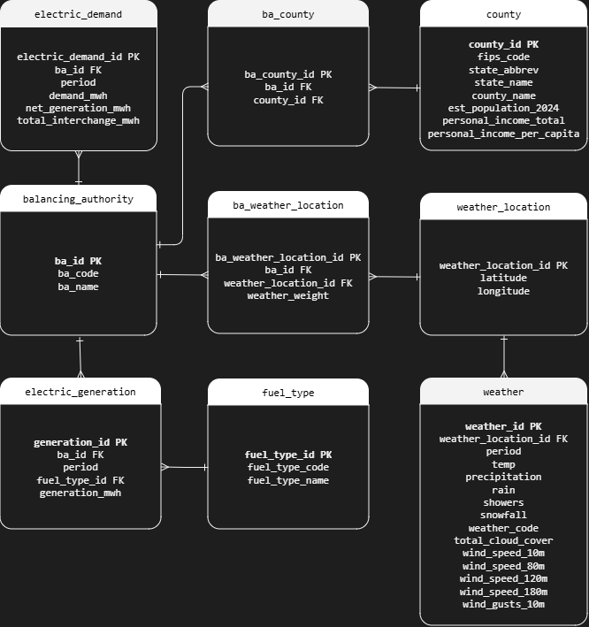

---

## Tools
| Category | Tools |
| ----- | ----- |
| Language | Python, SQL |
| APIs | EIA API, Open-Meteo API |
| Database | PostgresSQL, DBeaver |
| Orchestration | Apache Airflow | 
| Dashboard | Dash, Plotly |

---

## Analysis

The analysis covers the national electricity picture, differences between balancing authorities, and the impact of weather, population, and income.

Electrical values are in megawatt-hours (MWh). For scale, 1 MWh is enough to power the average U.S. home for over a month.

Balancing Authorities (BAs) are organizations that coordinate supply and demand across their service area, and can span large regions. BAs are the unit of analysis for generation and demand in this project.

### National Picture

Overall, generation closely matches demand, which makes sense since matching the two is the core job of a balancing authority. Natural gas is by far the largest source, producing nearly 50% of all electricity. Nuclear, coal, and wind follow.

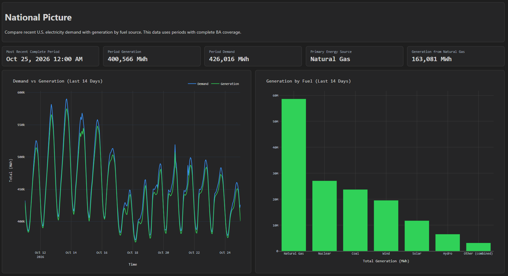

### Balancing Authorities

BAs are spread across the U.S. and vary widely in size, so raw totals are not comparable. Comparing each BAs peak demand to its own average demand (peak-to-average) normalizes this effect.

Normalized demand is fairly consistent across the U.S. The larger bubbles are mostly wind-heavy BAs with near-zero demand, where any demand at all makes their peak-to-average ratio look high.

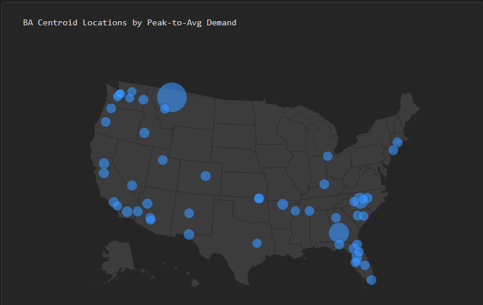

Many BAs generate 100% of their electricity from renewables (wind, solar, hydro).

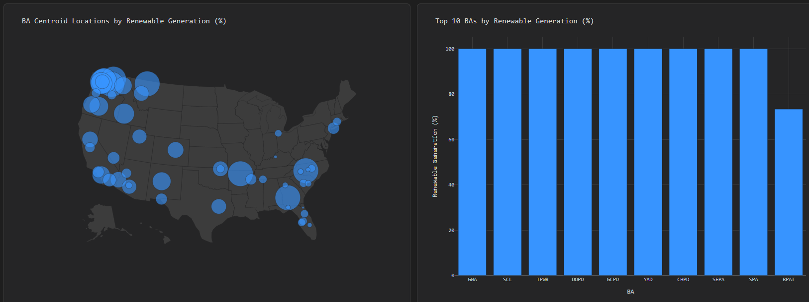

Interchange shows whether a BA is a net generator or net consumer. A value of 0% means a BA generates as much as they demand and is self-contained. A value of 100% means a BA generates electricity but with no demand of its own.

Most BAs demand more than they generate and depend on a small number of net-generating BAs to supply the difference.

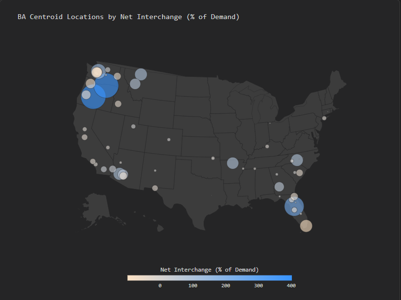

### Weather

Demand and temperature move closely together, rising during the day and falling at night.

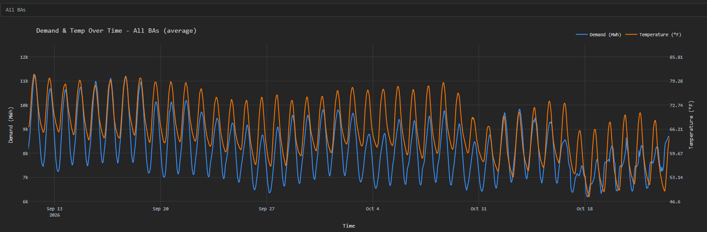

Comparing normalized demand against temperature across all BAs show a balance temperature of 50°F, the point where demand is lowest. Think of it as the tipping point between running the heat and running the air conditioning. At that temperature demand is about 0.84x the average.

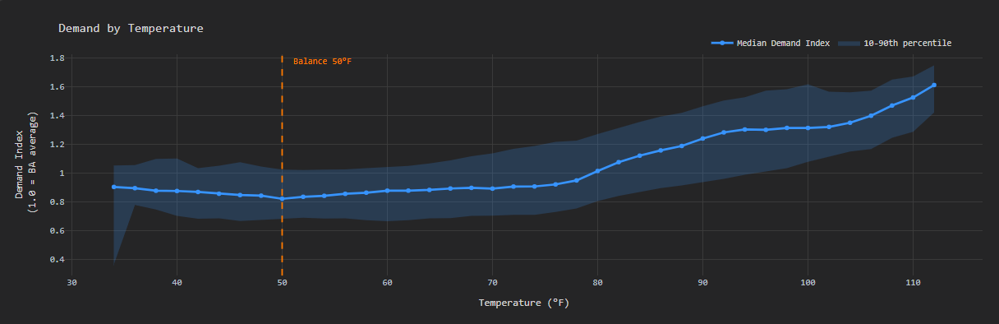

Weather condition has very little effect on demand or generation. Generation closely matches demand in every condition, and visible differences are likely due to low sample sizes for some conditions. Overall, the difference between conditions is negligible.

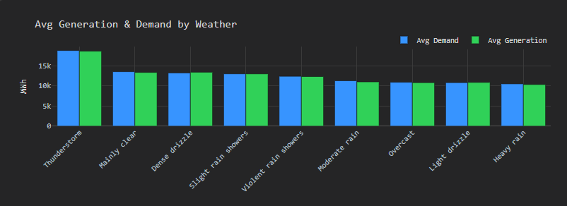

Across all BAs there no distinguishable trend between wind generation and wind speed, or between solar generation and cloud cover. However, some individual BAs do show a stronger positive correlation between wind generation and wind speed.

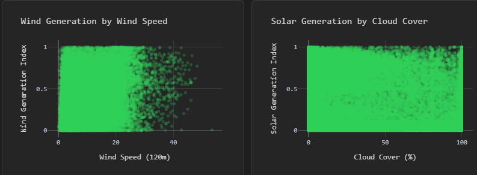

### Population & Income

Comparing average hourly demand per person across BAs shows how demand relates to population and income. Surprisingly, neither has much effect. The population trend line is nearly flat with an R² of 0, so there is essentially no correlation between population and demand per person.

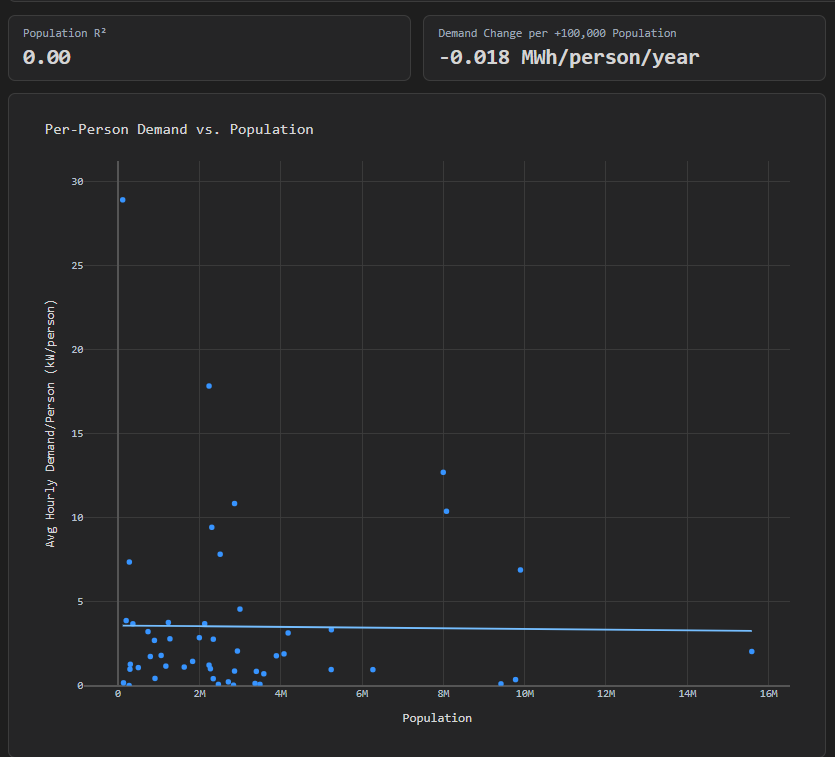

Income is similar. Its trend line is also fairly flat with an R² of 0.03, meaning there is almost no correlation between income and demand per person.

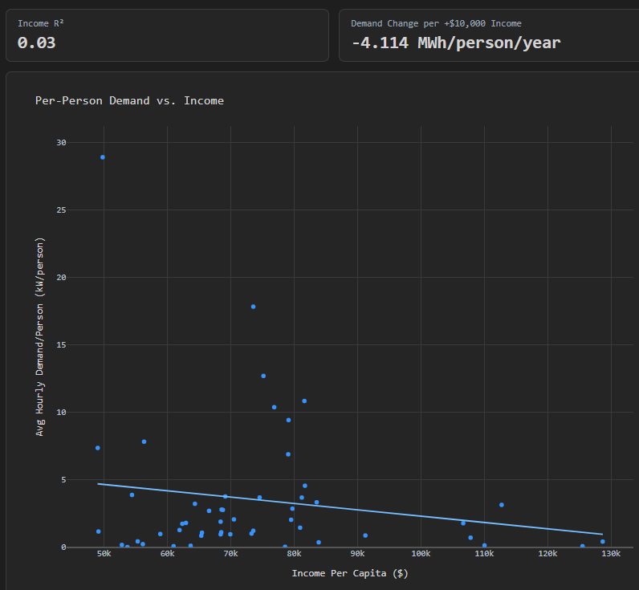

---

## Limitations

- Weather is mapped to representative locations for each BA, so it cannot capture every local condition, especially for BAs that cover large regions.
- The analysis covers a limited historical window and U.S. electricity data only. Seasonal conclusions, such as the balance temperature, may change with a full year or more of data.
- BA-level aggregation can hide differences among individual plants and communities.

## Next Steps

- Analyze precipitation, rain, and snow in relation to generation.
- Add solar UV data and examine its relationship with solar generation.
- Expand coverage and compare electricity use and generation across more regions.

---

## ETL Overview
Code: [`src/electricity/`](../src/electricity/)

This project uses APIs and static data to populate the database. The first time the ETL is run, it populates the database with historical API data *and* the static data. Every hourly run after that loads only new API data.

After extracting from the APIs and static datasets, the data is transformed into 9 tables following the [ERD](../db/electricity_erd.png) and [database schema](../db/electricity_schema.sql). The tables are then loaded into PostgreSQL using a SQLAlchemy connection.

---

## App Overview
Code: [`app/`](../app/)

The app displays all of the data and charts. It follows a page-by-page dashboard structure rather than a report structure.

The `Overview` tab gives a general summary. It shows a few overarching KPIs, supporting charts, and the research questions with key takeaways. At the bottom are dropdowns for definitions (Balance Authority, temperature measurements, etc.), limitations, and next steps. 

The Methodology section has a `Data` tab covering high-level temperature and demand trends and other summary metrics, like BAs and date ranges covered. It also has a dropdown for browsing each table in the database.

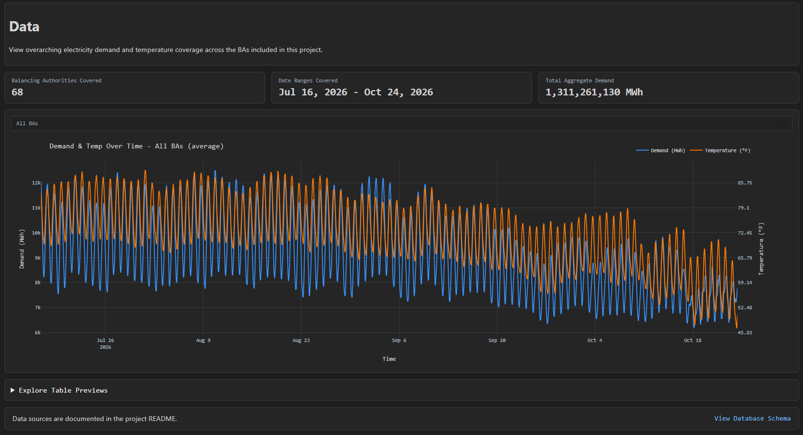

The `Pipeline` tab highlights the ETL process. It shows the last successful run, the next scheduled run, the pipeline flow, and the ERD. A map shows an example of how weather is weighted across a large BA.

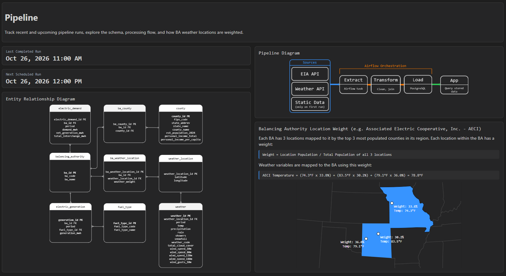

Lastly, the Grid Landscape section holds tabs for each part of the analysis: `National Picture`, `Balancing Authorities`, `Weather`, and `Population & Income`. Each tab has a few KPIs and charts.

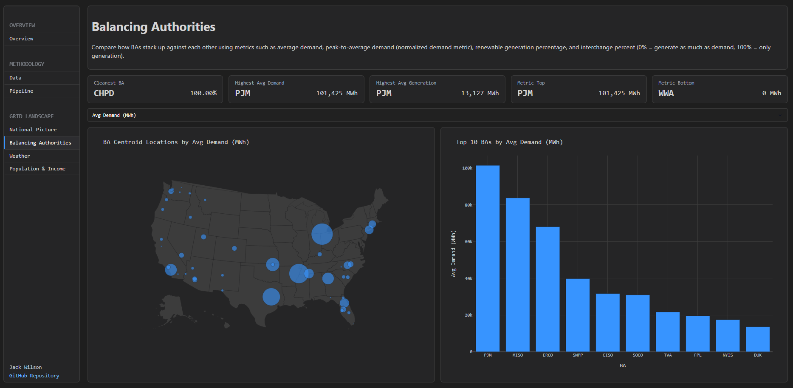

---

## Sources
Bureau of Economic Analysis. (n.d.). *Personal income (CAINC1): Personal income summary.* https://apps.bea.gov/regional/zip/CAINC1.zip

U.S. Census Bureau. (n.d.). *Population estimates: 2020s total population for cities and towns.* https://www.census.gov/data/tables/time-series/demo/popest/2020s-total-cities-and-towns.html

U.S. Census Bureau. (2021). *2020 gazetteer files.* https://www.census.gov/geographies/reference-files/2020/geo/gazetter-file.html 

U.S. Energy Information Administration. (n.d.). *EIA-860: Annual electric generator report.* https://www.eia.gov/electricity/data/eia860/ 

U.S. Energy Information Administration. (n.d.). *EIA-861: Annual electric power industry report.* https://www.eia.gov/electricity/data/eia861/

U.S. Energy Information Administration. (n.d.). *Open Data API.* https://www.eia.gov/opendata/ 

Open-Meteo. (n.d.). *Historical forecast API.* https://open-meteo.com/en/docs/historical-forecast-api 

Public Utility Data Liberation (PUDL). (n.d.). *out_eia861__yearly_balancing_authority_service_territory* [Data set]. Catalyst Cooperative. https://data.catalyst.coop/preview/pudl/out_eia861__yearly_balancing_authority_service_territory